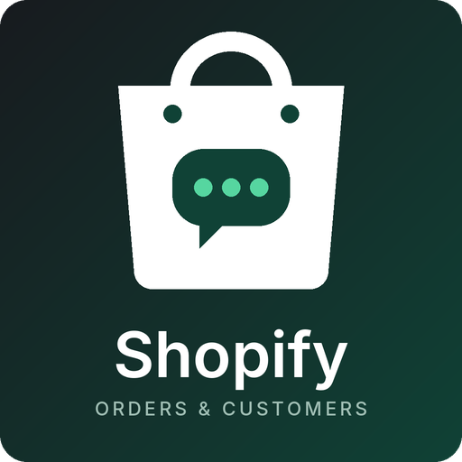
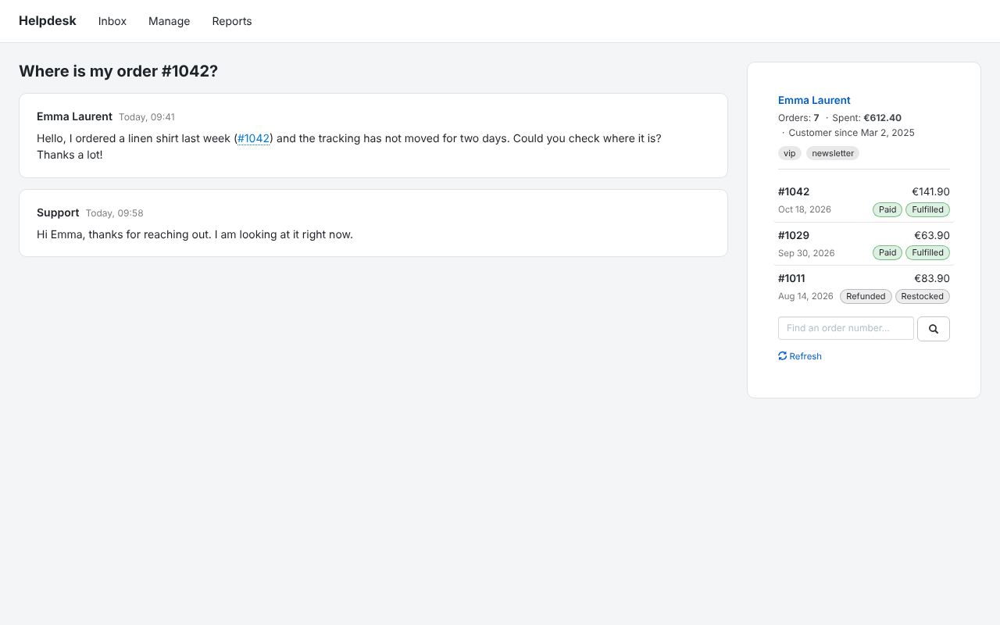
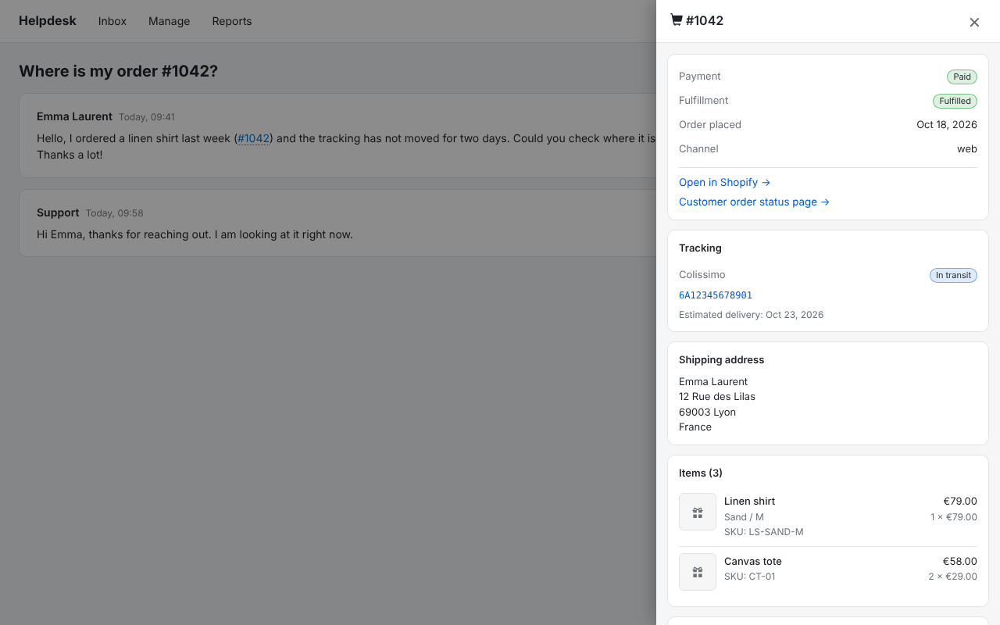
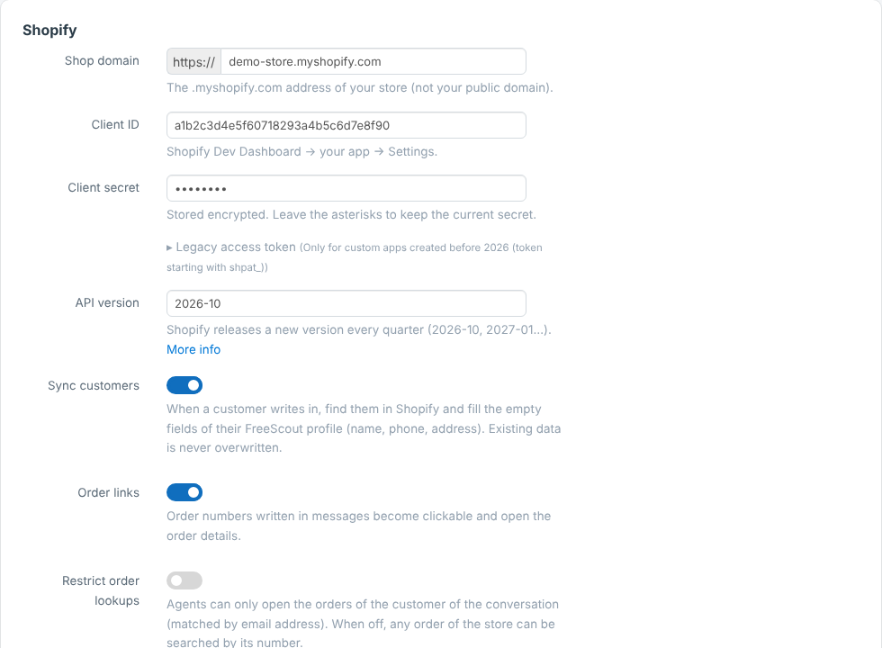
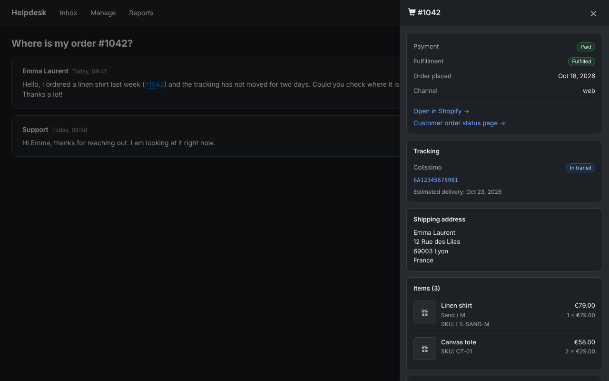

<p align="center">
  
</p>

<h1 align="center">Shopify</h1>
<p align="center">The Shopify customer and their orders, right inside your <a href="https://freescout.net">FreeScout</a> conversations.</p>

<p align="center">
  
  
</p>

## What you get

- 🛍️ **Customer and latest orders** next to every conversation.
- 🔎 **Order details in one click**: items, totals, refunds, tracking, shipping address.
- 🔗 **Clickable order numbers** in messages (`#1001`, `SHOP-1001`, "commande 1001"…).
- 👤 **Customer sync**: empty fields of the FreeScout profile are filled from Shopify.
- ⚙️ **Workflows & Tags**: use Shopify data in your rules.
- 🌙 Dark theme, translated into French, German, Spanish and Italian.
- 🔒 **Read-only**: nothing is ever changed in Shopify.

## Install (2 minutes)

1. Download **`Shopify.zip`** from the [latest release](https://github.com/haugtolas/freescout-shopify/releases/latest) and unzip it into `Modules/`.
2. **Manage → Modules** → activate **Shopify**, then run:
   ```
   php artisan migrate
   php artisan freescout:clear-cache
   ```

Requires FreeScout 1.8.190+ and PHP 7.1+ with cURL. Updates appear in **Manage → Modules** like for any other module.

## Connect your store (once)



1. In the [Shopify Dev Dashboard](https://dev.shopify.com/dashboard) create an app.
2. Set the scopes `read_orders` and `read_customers` (add `read_all_orders` to see orders older than 60 days).
3. **Release** the version and **install** the app on your store (same Shopify organization).
4. In FreeScout: **Manage → Settings → Shopify**, enter the shop domain (`my-store.myshopify.com`), the Client ID and the Client secret. Save: the connection is tested for you.

That is all. Apps created before 2026 can use their `shpat_…` token instead (field "Legacy access token").

<br clear="right">

<details>
<summary><b>More options</b></summary>

- **One store per mailbox**: **Mailbox → Settings → Shopify**; an empty domain means "use the global store".
- **Restrict order lookups**: agents can only open the orders of the customer of the conversation (matched by email).
- **Order number prefix**: `#` or your own, e.g. `SHOP-`.
- **`.env`**: `SHOPIFY_SHOP_DOMAIN`, `SHOPIFY_CLIENT_ID`, `SHOPIFY_CLIENT_SECRET`, `SHOPIFY_ACCESS_TOKEN`, `SHOPIFY_API_VERSION`, `SHOPIFY_SYNC_CUSTOMERS`, `SHOPIFY_LINK_ORDERS`, `SHOPIFY_ORDER_PREFIX` (the settings page overrides them).
- A queue worker (the usual FreeScout cron `php artisan schedule:run`) prefetches new conversations.

</details>

<details>
<summary><b>Workflows & Tags</b></summary>

With the **Workflows** module, the rule editor offers these conditions: Shopify customer exists, customer tags, number of orders, total spent, last order payment status, last order fulfillment status. And these actions: add a note with the Shopify summary, copy the Shopify tags as conversation tags (needs the **Tags** module).

Example: *customer has the tag `vip` → add the tag `VIP` and assign to an agent*. If Shopify cannot be reached, a Shopify condition is simply not met.

</details>

<details>
<summary><b>Privacy & security</b></summary>

- The module only talks to your Shopify store; no telemetry.
- Every request needs a logged-in user who can view the conversation; the browser never sends an email address.
- Only `*.myshopify.com` over HTTPS, no redirects. Secrets and the cached access token are encrypted.
- Orders that do not match the customer's email are flagged with a warning.
- Shopify data is cached up to 60 minutes (**Refresh** in the sidebar bypasses it).
- See [SECURITY.md](SECURITY.md) to report a vulnerability.

</details>

<details>
<summary><b>Troubleshooting</b></summary>

| Message | What to do |
|---|---|
| Shopify refused the credentials | Check Client ID / secret, and that the app is installed on this store. |
| The app and the store must belong to the same organization | Create the store from the Dev Dashboard of the organization that owns the app. |
| Missing permissions | Add the scope, release a new app version, accept the update (Shopify admin → Settings → Apps). |
| Orders older than 60 days are missing | `read_all_orders` is not granted. |
| Shop not found | Use the `.myshopify.com` domain. |

</details>

<details>
<summary><b>Dark theme</b></summary>

<p align="center"></p>

</details>

## Contributing

`php dev/tests/run.php` runs the tests (no network needed). See [CONTRIBUTING.md](CONTRIBUTING.md) and [CHANGELOG.md](CHANGELOG.md).

## Licence

AGPL-3.0, see [LICENSE](LICENSE). Copyright (C) 2026 Shopify contributors.
